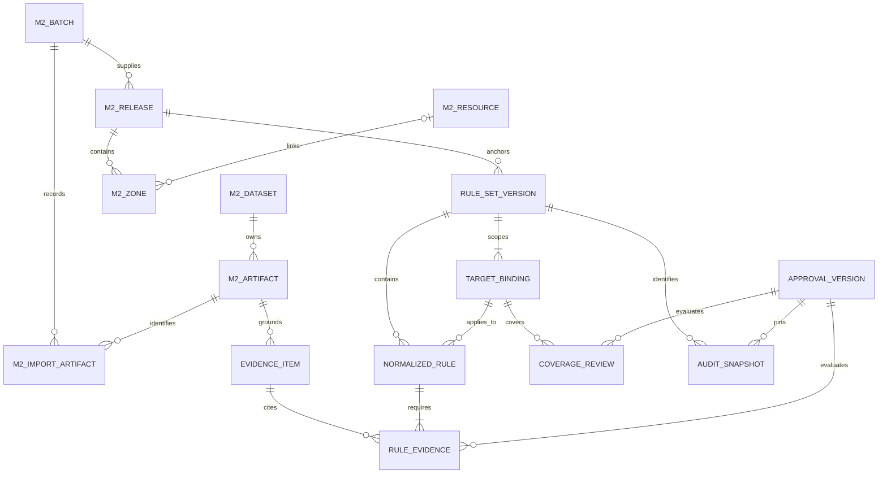

# CurbOS M3 design specification

**PR-00 · Proposed for human review · 2026-11-21**

**Baseline** `3483502f2afec0159ca430abb9e8fc5a62e7a7f5`, the merge of M2 Closeout PR #14.

M3 designs a rules engine that evaluates legal eligibility for one parking target and the entire requested stay. It returns a legal outcome with reasons and exact evidence versions. Cost, physical fit, occupancy and arrival availability remain separate dimensions. Launch scope, authoritative sources and precedence remain human decisions.

## Repository and contract reconciliation

| Existing contract | M3 consequence |
|---|---|
| One Go module serves liveness, readiness and Discovery. pgx adapters live under `backend/internal/platform/postgres`. | Propose a pure `backend/internal/regulations` package within the existing module. The application owns data loading and use-case orchestration. [Go module](../../backend/go.mod) · [Existing API](../../backend/cmd/api) |
| Goose `00001`–`00006` provide PostGIS, release-scoped evidence and identity, publication and verification, and withdrawal-safe Discovery reads. `rules.release_policy_definition` stores raw definitions with parse status. Zone → resource links are optional. | Keep M2 tables and data flows authoritative for their existing purposes. A future additive rules schema can attach a reviewed, versioned rule representation to exact M2 lineage. A source UUID never becomes a physical resource UUID by default. [Evidence DDL](../../db/migrations/00002_m2_evidence_foundation.sql) · [Withdrawal DDL](../../db/migrations/00006_m2_scope_withdrawal_reads.sql) |
| CDS distinguishes unique reference resolution from structural usability and quarantines unusable inputs. The current Discovery API discloses source-reported geometry, Policy references and unknown legal status. | Never promote a parsed DS11 Policy or a source-reported street side into legal authority. Parsed DS11 can be linked as source evidence for a separately reviewed mapping. Keep the Discovery routes, OpenAPI and frontend behavior intact. [Validation runbook](../../data/cds_validate/README.md) · [Discovery contract](../../contracts/openapi/DISCOVERY.md) |
| M2 engineering is accepted for the bounded implementation. Real-source acceptance is blocked, public release is NO-GO, and the original composed browser-to-database positive render remains unassessed. PR-07 reports supplied approvals as unverified. | Early slices use isolated synthetic evidence. Neither an opaque approval reference nor technical readiness satisfies a legal or publication gate. Qualifying private real-source work and any public claim need separate authorization. [M2 acceptance and gates](M2_ACCEPTANCE_REPORT.md) · [Readiness runbook](../../data/cds_readiness/README.md) |

Three apparent contract conflicts matter. The architecture roadmap's shorthand “verified GIS map” cannot be read as approval to serve real curb geometry. The architecture's future search and resource routes describe a later API and do not supersede the merged Discovery contract. The M2 table name `release_policy_definition` denotes source definitions, while M3 needs independently normalized authority and applicability. These interpretations follow the approved baseline and M2 closeout. No amendment to an accepted ADR is required by this proposal. [Architecture baseline](../core/ARCHITECTURE_BASELINE_v1.0.md) · [Decision register](../architecture/DECISION_REGISTER.md) · [M3 handoff](M3_DESIGN_REVIEW_HANDOFF.md)

## Module and data ownership

1. **Regulations** owns the normalized rule vocabulary, applicability, interval evaluation and explainable outcomes. The core uses only typed inputs and pinned in-memory data. It has no database, router, configuration lookup, wall-clock read or network dependency.
2. **Application use case** owns request authorization, clock capture, immutable snapshot selection, cancellation, and any authorized audit receipt. It uses a small read boundary only when the PostgreSQL integration lands.
3. **Geo and ingestion** own location and evidence lineage. A regulation binds to either a reviewed physical resource with an exact geometry/side revision or a source Zone identified by dataset, release and source key with an independently reviewed target binding. The latter conveys no physical identity mapping. Local target selectors also bind to a direction-versioned road or block-face reference so `LEFT` and `RIGHT` have a stable meaning.
4. **PostgreSQL** remains authoritative for installed evidence, immutable version relationships and current serving eligibility. The evaluator owns no M2 writes. An authorized future publishing workflow may prepare a new rule version through ADR-028, with a separate decision on when it can serve. [ADR-028](../adr/ADR-028_VALIDATED_STAGING_ATOMIC_PUBLICATION.md)

## Proposed relational model

Conceptual relationships. Only the entities prefixed `M2` exist at this baseline. The rule schema is a design for a later PR, with no DDL or runtime changes in PR-00.

- `RULE_SET_VERSION` binds rule-set ID and digest, exact release/scope/batch, normalizer and semantics versions, calendar and timezone-data digests, and the approved authority profile version. A new ruleset or review binds to a new immutable version. Runtime serving eligibility is separate.
- `TARGET_BINDING` carries target kind, exact ID and geometry revision, oriented segment, curb side, jurisdiction and reviewed scope. Include either the reviewed canonical resource link or the exact release-scoped Zone key. Scope, batch, release, target and geometry match through composite keys and verified joins. An unreviewed link or ambiguous geographic match produces `UNKNOWN`.
- `NORMALIZED_RULE` carries version and target key, effect, typed conditions, effective period, recurring schedule or absolute interval, exception links and authority. Versioned child schedules, exceptions and evidence links share the rule-set key. Proposed storage can keep bounded, typed schedules in validated structured fields initially. Index by release/target and effective window only when queries justify it.
- `EVIDENCE_ITEM` carries dataset/batch/artifact/record locator, digest, observed and source-as-of times, issuing jurisdiction and rights. Evidence from an additional authority needs its own traced dataset, batch and artifact revisions and an exact binding into this rule set. It may never be borrowed from an unrelated release via “latest.”
- `APPROVAL_VERSION` identifies verified reviewer, authority, independence, exact evidence/coverage digests, review decision, validity and predecessor/revocation record. `COVERAGE_REVIEW` records required evidence layers, complete/partial/unknown windows, target/vehicle/permit coverage, and the exception and override classes checked. Approval claims alone leave the coverage unverified.
- `AUDIT_SNAPSHOT` describes a private, versioned receipt for replay, including semantics, authority, rules, review and time versions with the minimal request facts. Storage, access, redaction, retention and erasure require approval before persisting real evaluations. Synthetic integration can use in-memory receipts. No raw permits, home addresses or source payloads are required.

## Design decision register

| ID | Status and decision | Required approval |
|---|---|---|
| A1 | **Accepted ADR-006, 007, 013, 026.** Keep evidence dimensions independent, preserve `UNKNOWN`, and reserve verified recommendations for their evidence and eligibility gates. | Existing authority. |
| A2 | **Accepted ADR-002, 005, 022.** Keep physical resource identity, subtype, source ID and geometry revision distinct. | Existing authority. |
| A3 | **Accepted ADR-004, 015, 016, 021, 023, 024, 027, 028.** Use the Go monolith, PostgreSQL authority, conservative arbitration, typed contract boundaries and immutable versioned evidence. | Existing authority. |
| D1 | **Proposed.** Half-open stays, explicit instant endpoints, versioned jurisdiction calendars and timezone rules, elapsed-duration cap of 168 hours for synthetic profiles. Full stays require complete continuous coverage for permission. | Before synthetic PR-01, approve request bounds, interval composition and status vocabulary. Before PR-02, approve calendar, fold/gap and maximum-stay semantics. Real limits and calendars require separate review. |
| D2 | **Proposed.** A restriction may decide `PROHIBITED` for an overlapping interval when its authority, applicability and every potentially outcome-changing exception/override are established. Unresolved contradictions stay unknown unless an approved rule of precedence selects the effect. | Before synthetic PR-01, approve the negative-proof contract and synthetic precedence fixtures. Before real-source use, approve scoped jurisdiction and rule-class precedence. |
| D3 | **Proposed.** Require exact side and geometry provenance and three-valued vehicle/permit applicability. First slice supports only single, explicitly reviewed synthetic targets and coarse vehicle classes, with opaque permit classes. | Before synthetic PR-01, approve fixture target kinds, minimum request fields and reason codes. Before real use, approve supported resources, permits and privacy constraints. |
| D4 | **Proposed.** Use a pure engine followed by an internal, read-only PostgreSQL loader and an explicit use-time eligibility check. Pin one bundle per evaluation. | Before synthetic PR-01, approve internal boundary. Before persistence work, approve composite keys, live revocation semantics and audit retention. |
| D5 | **Unresolved.** Pilot, authoritative laws/signs/orders, usage rights, evidence freshness, independent reviewer qualification and coverage thresholds. | Before any private real-source work, select permitted geography and sources, authorize private use, define acceptable placement/coverage and complete the independent evidence review. |
| D6 | **Unresolved.** Authorization for public legal claims, public contract, rights, independence, freshness, error/redaction policy, operational safeguards and withdrawal latency. | Separate public decision after M2 real-source and publication gates, independent M3 real eligibility evidence, a withdrawal rehearsal, and legal/operational review. |

No universal authority hierarchy is proposed. D1–D4 are review choices for this milestone, with design constraints traced to the existing ADRs. D5 and D6 remain open regardless of synthetic implementation progress.

**Engineering Learning Note.** A source Policy can parse and resolve against a Zone while leaving the authority, curb side and temporary restrictions unknown. An eligibility snapshot must preserve each of those distinctions so a completed computation cannot turn source coverage into legal permission.

[Rule evaluation contract](M3_RULE_EVALUATION_CONTRACT.md) · [Synthetic test matrix](M3_TEST_MATRIX.md) · [PR sequence and gates](M3_PR_PLAN_AND_GATES.md)
