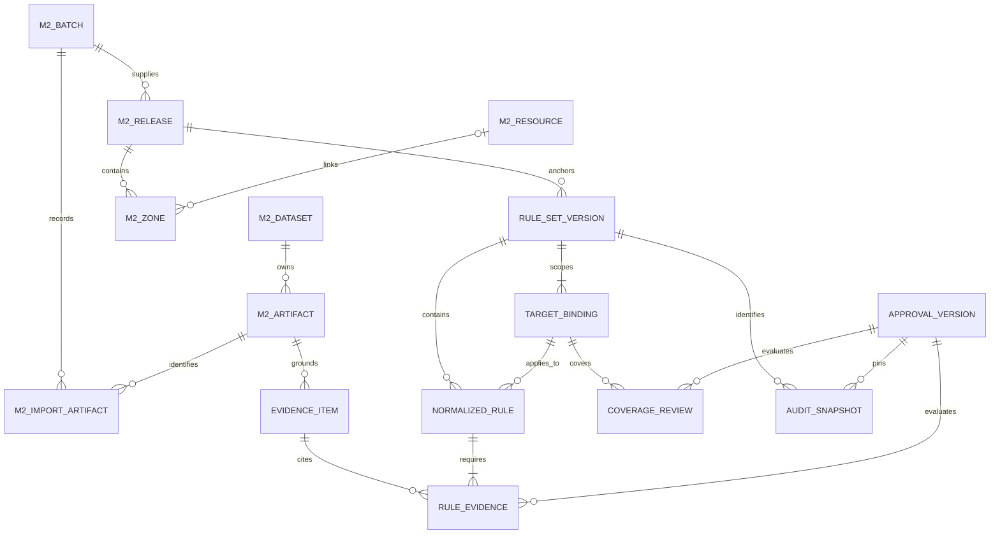

# CurbOS M3 design specification

**PR-00 · Human design decisions reconciled in M3-00D · 2026-11-21**

**Baseline** `3483502f2afec0159ca430abb9e8fc5a62e7a7f5`, the merge of M2 Closeout PR #14.

**M3-02D baseline** `55c1a60f204f443843d4674b8322553a778b9fa5`, the merge of PR-01. This follow-up records the synthetic civil-time design freeze and the decisions still needed before PR-02.

Strict Legal Eligibility evaluates one parking target across the entire requested stay and returns both a whole-stay outcome and first-class interval results. Evidence-Aware Discovery helps users explore source evidence when legal proof is incomplete. An `UNKNOWN` interval stays unknown even when another interval decisively prohibits the whole stay. Cost, physical fit, occupancy, prediction, popularity and historical trends remain separate from legal outcomes.

## Minimal Core and future product boundaries

- **PR-01** is a synthetic-only pure Go Minimal Core. It evaluates absolute UTC intervals at exact change events, with no fixed-minute sampling. Fixture assumptions are explicit inputs to tests. They carry no independent real-world approval or production authority.
- **Later M3** adds civil-time normalization, reviewed scope and authority, exclusion-aware legal coverage, and versioned evidence handling in separate slices. Structural source QA, complete source reference links and geometry coverage establish no legal coverage completeness. Preserve potentially relevant excluded or unsupported records as unresolved evidence until reviewed scope, applicability, validity or precedence resolves them.
- **Future product architecture** separates **Verified Legal Candidates**, **Potential Discovery** and **Known Restrictions** in MapLibre. Verified Legal Candidates require an authorized full-stay permission and other applicable product gates. Potential Discovery labels legal uncertainty. Known Restrictions identify their supported scope and interval. Prediction, occupancy, popularity and historical trends may inform their own surfaces, with no effect on the legal outcome. Community reports remain unverified evidence for review. Review alone does not establish issuing authority.
- **Existing gates** remain `ENGINEERING_ACCEPTED` for the bounded M2 synthetic engineering slice, `REAL_SOURCE_ACCEPTANCE_BLOCKED`, and `REAL_PUBLICATION_NO_GO`. Independent source rights, geometry and curb placement, legal coverage and authority verification remain outstanding. A completed design review still requires separate explicit coding authorization. [M2 acceptance and blocker register](M2_ACCEPTANCE_REPORT.md#blocker-register)

## Repository and contract reconciliation

| Existing contract | M3 consequence |
|---|---|
| One Go module serves liveness, readiness and Discovery. pgx adapters live under `backend/internal/platform/postgres`. PR-01 provides the pure absolute-time evaluator. | PR-02 supplies normalized synthetic windows to `backend/internal/regulations`. The future application owns data loading and use-case orchestration. [Go module](../../backend/go.mod) · [Absolute evaluator](../../backend/internal/regulations/evaluate.go) |
| Goose `00001`–`00006` provide PostGIS, release-scoped evidence and identity, publication and verification, and withdrawal-safe Discovery reads. `rules.release_policy_definition` stores raw definitions with parse status. Zone → resource links are optional. | Keep M2 tables and data flows authoritative for their existing purposes. A future additive rules schema can attach a reviewed, versioned rule representation to exact M2 lineage. A source UUID never becomes a physical resource UUID by default. [Evidence DDL](../../db/migrations/00002_m2_evidence_foundation.sql) · [Withdrawal DDL](../../db/migrations/00006_m2_scope_withdrawal_reads.sql) |
| CDS distinguishes unique reference resolution from structural usability and quarantines unusable inputs. The current Discovery API discloses source-reported geometry, Policy references and unknown legal status. | Never promote a parsed DS11 Policy or a source-reported street side into legal authority. Parsed DS11 can be linked as source evidence for a separately reviewed mapping. Keep the Discovery routes, OpenAPI and frontend behavior intact. [Validation runbook](../../data/cds_validate/README.md) · [Discovery contract](../../contracts/openapi/DISCOVERY.md) |
| M2 engineering is accepted for the bounded implementation. Real-source acceptance is blocked, public release is NO-GO, and the original composed browser-to-database positive render remains unassessed. PR-07 reports supplied approvals as unverified. | Early slices use isolated synthetic evidence. Neither an opaque approval reference nor technical readiness satisfies a legal or publication gate. Qualifying private real-source work and any public claim need separate authorization. [M2 acceptance and gates](M2_ACCEPTANCE_REPORT.md) · [Readiness runbook](../../data/cds_readiness/README.md) |

Three apparent contract conflicts matter. The architecture roadmap's shorthand “verified GIS map” cannot be read as approval to serve real curb geometry. The architecture's future search and resource routes describe a later API and do not supersede the merged Discovery contract. The M2 table name `release_policy_definition` denotes source definitions, while M3 needs independently normalized authority and applicability. These interpretations follow the approved baseline and M2 closeout. No amendment to an accepted ADR is required by this proposal. [Architecture baseline](../core/ARCHITECTURE_BASELINE_v1.0.md) · [Decision register](../architecture/DECISION_REGISTER.md) · [M3 handoff](M3_DESIGN_REVIEW_HANDOFF.md)

## Module and data ownership

1. **Regulations** owns the normalized rule vocabulary, applicability, interval evaluation and explainable outcomes. The core uses only typed inputs and pinned in-memory data. It has no database, router, configuration lookup, wall-clock read or network dependency.
2. **Application use case** owns request authorization, clock capture, immutable snapshot selection, cancellation, and any authorized audit receipt. It uses a small read boundary only when the PostgreSQL integration lands.
3. **Geo and ingestion** own location and evidence lineage. A regulation binds to either a reviewed physical resource with an exact geometry/side revision or a source Zone identified by dataset, release and source key with an independently reviewed target binding. The latter conveys no physical identity mapping. Local target selectors also bind to a direction-versioned road or block-face reference so `LEFT` and `RIGHT` have a stable meaning.
4. **PostgreSQL** remains authoritative for installed evidence, immutable version relationships and current serving eligibility. The evaluator owns no M2 writes. An authorized future publishing workflow may prepare a new rule version through ADR-028, with a separate decision on when it can serve. [ADR-028](../adr/ADR-028_VALIDATED_STAGING_ATOMIC_PUBLICATION.md)

## Proposed relational model

Conceptual relationships. Only the entities prefixed `M2` exist at this baseline. The rule schema is a design for a later PR, with no DDL or runtime changes in PR-00.

- `RULE_SET_VERSION` binds rule-set ID and digest, exact release/scope/batch, normalizer and semantics versions, calendar and timezone-data digests, and the approved authority profile version. A new ruleset or review binds to a new immutable version. Runtime serving eligibility is separate.
- `TARGET_BINDING` carries target kind, exact ID and geometry revision, oriented segment, curb side, jurisdiction and reviewed scope. Include either the reviewed canonical resource link or the exact release-scoped Zone key. Scope, batch, release, target and geometry match through composite keys and verified joins. An unreviewed link or ambiguous geographic match produces `UNKNOWN`.
- `NORMALIZED_RULE` carries version and target key, effect, typed conditions, effective period, recurring schedule or absolute interval, exception links and authority. Versioned child schedules, exceptions and evidence links share the rule-set key. Proposed storage can keep bounded, typed schedules in validated structured fields initially. Index by release/target and effective window only when queries justify it.
- `EVIDENCE_ITEM` carries dataset/batch/artifact/record locator, digest, observed and source-as-of times, issuing jurisdiction and rights. Evidence from an additional authority needs its own traced dataset, batch and artifact revisions and an exact binding into this rule set. It may never be borrowed from an unrelated release via “latest.”
- `APPROVAL_VERSION` identifies verified reviewer, authority, independence, exact evidence/coverage digests, review decision, validity and predecessor/revocation record. `COVERAGE_REVIEW` records required legal evidence layers, exclusions with possible applicability, and the exception and override classes checked. The required layers include base restrictions, signs, permits, exceptions, temporary orders, and potentially relevant excluded or unsupported records. Structural coverage is recorded separately. A prohibition depends on restriction-specific negative proof. Approval claims alone leave the coverage unverified.
- `AUDIT_SNAPSHOT` describes a private, versioned receipt for replay, including semantics, authority, rules, review and time versions with the minimal request facts. Storage, access, redaction, retention and erasure require approval before persisting real evaluations. Synthetic integration can use in-memory receipts. No raw permits, home addresses or source payloads are required.

## Design decision register

| ID | Status and decision | Required approval |
|---|---|---|
| A1 | **Accepted ADR-006, 007, 013, 014, 026.** Keep evidence dimensions independent, preserve `UNKNOWN`, review and trace community evidence, and reserve verified recommendations for their evidence and eligibility gates. | Existing authority. |
| A2 | **Accepted ADR-002, 005, 022.** Keep physical resource identity, subtype, source ID and geometry revision distinct. | Existing authority. |
| A3 | **Accepted ADR-004, 015, 016, 021, 023, 024, 027, 028.** Use the Go monolith, PostgreSQL authority, conservative arbitration, typed contract boundaries and immutable versioned evidence. | Existing authority. |
| D1 | **Merged PR-01 contract.** Exact event-driven UTC half-open evaluation, whole-stay outcome and exact interval partition. The inclusive limits are 168 elapsed hours, 256 rules, 1,024 raw windows, 1,024 unique temporal boundaries, 2,048 evidence references and 2,050 derived endpoint entries. | The existing absolute evaluator and limits govern normalized PR-02 inputs. |
| D1-A–E | **Frozen in M3-02D for synthetic evaluation.** Explicit jurisdiction and immutable IANA timezone bytes, civil-label recurrence with a starting-day overnight anchor, exact UTC offset-span projection including DST gaps and folds, reviewed synthetic calendar operations, and a continuous elapsed cap with an explicit occupancy anchor. | `OPEN_DECISION` for jurisdiction-specific calendar, DST, overnight, occupancy and enforcement interpretations. Unsupported rules stay unresolved pending reviewed source-specific treatment in PR-03 or later. [Civil-time contract](M3_RULE_EVALUATION_CONTRACT.md#pr-02-civil-time-design) |
| D1-F | **Frozen in M3-02D.** Bound normalization before the absolute sweep. Charge each generated entry against the shared PR-01 budgets and fail closed on excess. | `OPEN_DECISION` on approval of the proposed pre-expansion ceilings. Approve or revise them, then give separate explicit coding authorization for PR-02. [Bounded normalization](M3_RULE_EVALUATION_CONTRACT.md#d1-f--bounded-normalization) |
| D2 | **Accepted in M3-00D.** Authority is scope-, applicability-, effective-time- and provenance-bound, with explicit precedence. Permission requires exclusion-aware legal completeness. One decisive restriction can prohibit the stay after checking its potentially controlling exceptions and overrides. | PR-01 uses synthetic assumptions. `OPEN_DECISION` for PR-03 certificate representation and verification, such as one scoped manifest or linked layer attestations. Real precedence remains jurisdiction- and rule-specific. |
| D3 | **Accepted in M3-00D.** Bounded synthetic pure Go Minimal Core with one exact fixture binding, absolute time and simple permits. No fixture approval carries production authority. | `OPEN_DECISION` before real use for eligible resource kinds, verified permit facts and minimum private inputs. The proposed minimal fixture shapes remain implementation details for PR-01 review. |
| D4 | **Accepted staging in M3-00D.** PR-04 additive persistence, PR-05 coherent loading and current-use revocation, PR-06 synthetic replay. | `OPEN_DECISION` at integration for exact composite keys, revocation generation (per scope or per relied-upon component), audit access and retention. |
| D5 | **`OPEN_DECISION`.** Pilot, lawful use, authoritative laws/signs/orders, freshness, independent reviewer qualification and legal coverage thresholds. | Authorize a bounded private real-source pilot after verification, or retain synthetic-only scope. M2 blockers remain in force. |
| D6 | **`OPEN_DECISION`.** Public legal claims, public contract, rights, independence, freshness, redaction, withdrawal latency and operational safeguards. | Retain `NO_GO` unless separate M2 release, real M3 eligibility and public authorization gates are met. Future MapLibre separation is a product architecture decision only. |

No universal authority hierarchy applies. Record issuing provenance, scoped precedence and the relevant effective dates. Temporary restrictions also need explicit observed dates and a reviewed freshness bound. An absence of new reports leaves temporary-restriction coverage unknown unless separate authoritative coverage establishes it.

**Engineering Learning Note.** A source Policy can parse and resolve against a Zone while leaving the authority, curb side and temporary restrictions unknown. An eligibility snapshot must preserve each of those distinctions so a completed computation cannot turn source coverage into legal permission.

[Rule evaluation contract](M3_RULE_EVALUATION_CONTRACT.md) · [Synthetic test matrix](M3_TEST_MATRIX.md) · [PR sequence and gates](M3_PR_PLAN_AND_GATES.md)
